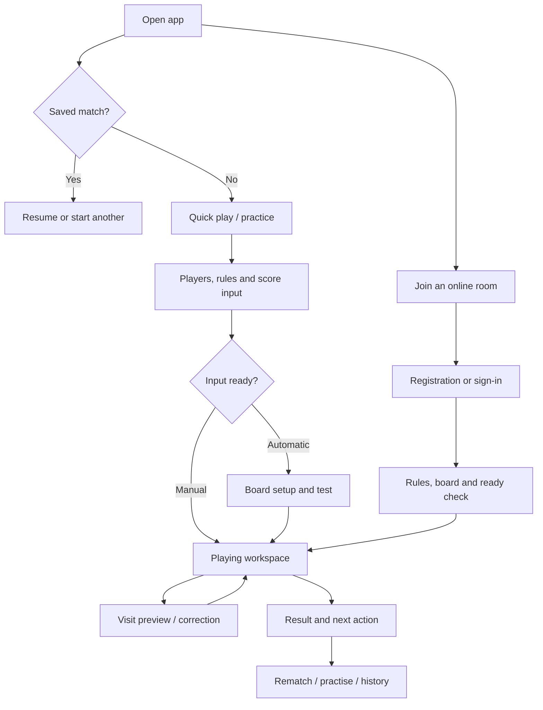

# UI, UX and brand implementation brief

This is the experience workstream for the [full implementation plan](IMPLEMENTATION_PLAN.md). It describes intended design work, not a finished identity or a claim that all screens exist. The current green/cream interface and “Darts Master” title are provisional.

## 1. Experience principles

1. Playing comes first. At the oche, the player should see whose turn it is, the score, the current draft and the next action without searching through product navigation.
2. Score entry is confident and reversible. Preview and accepted scores look different; correction explains its effect; dangerous changes protect an unfinished game.
3. The same game works across inputs. Board taps, precision controls, keypad and supported detection use the same vocabulary and rules.
4. Information reflects evidence. A detected score, manually entered total, simulated opponent and disputed result must not imply identical verification or data completeness.
5. Local play starts quickly. Registration, tours and camera permissions are introduced when they are relevant, not placed in front of every guest game.
6. Social features feel like a darts room. Names, teams, fixtures, presence and conversation should be recognisable to players, without an overloaded generic dashboard.
7. Failure is part of the flow. Offline, reconnecting, uncalibrated, permission-denied and unsaved states need designed recovery actions.

## 2. Research and validation deliverables — UX-01–04

- Document the primary player, scorer, captain and organiser jobs; cover home/remote players, club/team users and organisers in the first polished release, as confirmed by the owner.
- Observe real scoring sessions on the Dell, a phone and a board-side tablet. Include a new user, a regular darts player and someone operating the scorer for other people.
- Compare the same tasks in a small set of current darts products: start a match, enter/correct a visit, finish a leg, connect a board, join a remote match and run an event. Date the audit and use observed evidence, not remembered feature claims.
- Record the current prototype’s friction: repeated headings/chrome, essential controls below the fold, tiny metadata, ambiguous saved/unsaved state, and the growing setup form. Validate these observations during real use.
- Create low-fidelity flow prototypes first, then high-fidelity screens using identical representative data.
- Run moderated task tests with an initial 5–8 people covering the core roles. This is an initial feedback sample, not proof of statistical superiority.

**Deliverables:** task matrix; screen/route map; current-state screenshots; friction log ranked by severity; annotated prototypes; usability findings; prioritised follow-up changes.

**Initial task gates:** a new user starts a guest game in under one minute; can correct a misplaced dart without arithmetic/help; understands when a visit is recorded; can recover an interrupted game; can distinguish a local player profile from a registered account.

## 3. Information architecture

Keep implemented navigation concise. Do not expose a long menu of non-functional destinations just to illustrate the future vision.

| Area            | Main destinations                                       | Main action                       |
| --------------- | ------------------------------------------------------- | --------------------------------- |
| Play            | Quick match, resume, local game, invited room           | Start / resume a game             |
| Practice        | Bot match, drills, routines, progress                   | Start a practice session          |
| Players         | Saved profiles, account profile, records, comparisons   | Select a player / review progress |
| Rooms           | Invites, lobby, active match, spectating                | Join / host                       |
| Teams & clubs   | Team home, members, line-up, lobby, fixtures            | Prepare a session                 |
| Competitions    | Events, bracket/groups, schedule, standings             | Enter / organise                  |
| Boards          | Paired boards, camera setup, health, calibration        | Connect / test a board            |
| History         | Results, filters, detail, replay/export                 | Find / inspect a result           |
| Settings & help | Account, privacy, notifications, accessibility, support | Control the experience            |
| Operations      | Referee, moderation and administration screens          | Role-authorised management        |

Use actual routes and deep links for meaningful destinations, rather than keeping the entire product in one tab state. Preserve back-button behaviour and unsaved-work handling.

## 4. Device layouts

### Desktop / laptop

- Use a compact app header and a stable playing workspace, with the scoreboard, board/input and current-visit actions visually connected.
- Place recent visits and checkout information where they support the current throw rather than stretching a decorative card.
- Keep record/correct controls reachable on ordinary laptop viewports; test 1366×768 as well as larger displays. A large screenshot on a tall display is not sufficient.
- Provide a focused match view that reduces navigation and secondary statistics, with an obvious exit.
- Use wider layouts for brackets, league tables and organiser tools without making touch use impossible.

### Board-side tablet

- Large, separated touch controls, glare/contrast testing and reliable orientation changes.
- Make the active thrower and confirmed remaining score readable at a distance.
- Offer board and precision entry without forcing taps on a narrow ring. Avoid hover-only instructions.
- Optional score calling, fullscreen and keep-awake behaviour after a user action and capability check.

### Phone

- Reduce decorative headings/sidebar footprint in the playing view.
- Use a compact score strip and a reachable draft/record/correction area. Do not require repeated top-to-bottom scrolling between throw and confirmation.
- Choose adaptive bottom/overflow navigation only after testing; show only delivered areas.
- Test the software keyboard, safe areas, portrait/landscape, long names, browser zoom and interrupted/resumed sessions.
- Precision number controls are a first-class alternative to small board targets.

### TV / venue display

- Read-only scoreboard/spectator mode first: high legibility, names, legs/sets, active player and event context.
- Use a separate authorised phone/tablet scorer or board service for input.
- Provide clear pairing/join instructions and an offline state. Test browser/remote-control limitations on the actual target device before advertising support.

## 5. Critical journeys and state coverage

| Journey              | Required screens/states                                                                       | Recovery / acceptance                                                                   |
| -------------------- | --------------------------------------------------------------------------------------------- | --------------------------------------------------------------------------------------- |
| First guest match    | Entry, minimal setup, score input, first visit, finish, result                                | No account or camera needed; can resume after refresh                                   |
| Saved player game    | Create/select profile, rules, match, result, player record                                    | Clearly links the chosen identity; no guessing from a typed name                        |
| Practice             | Difficulty/routine, whose turn, pause, correction, session result                             | Opponent timing never blocks a human correction; practice records labelled              |
| Board connection     | Discovery/pairing, permissions, capture ownership, calibration, test, healthy/error           | A failed setup explains the next action and leaves manual play available                |
| Registration         | Sign-up, verify, resend/expired link, login, recovery, settings                               | Existing local game remains available; clear outcome for interrupted or duplicate flows |
| Data linking         | Local data selection, ownership confirmation, conflicts, import, outcome                      | No silent history merge; retry is safe and local recovery copy remains                  |
| Remote game          | Invite, authentication, room roles, rules, media/board checks, ready, live, reconnect, result | Users see accepted versus pending actions and one official score                        |
| Team session         | Invite/members, availability, captain line-up, ready room, board assignment, result           | Missing member, substitute, offline board and captain departure paths exist             |
| Tournament           | Create/configure, entrants/check-in, draw, assignments, live rounds, dispute, final           | Byes/no-shows/corrections do not lead to dead-end screens                               |
| Streaming / replay   | Preview, permission, audience, live/muted/error/ended, recording, clip/detail                 | Video can fail without losing score; recording/audience state is visible                |
| Support / moderation | Report, block/mute, case status, role-authorised action                                       | A usable route exists from the context of the problem                                   |

Every released screen needs applicable empty, loading, error, offline, permission-denied, stale, success and unsaved states. Do not substitute a spinner or toast for a recoverable workflow.

## 6. Match-screen interaction specification

- **Score hierarchy:** confirmed remaining score → active thrower → draft darts/points → next action → legs/sets → contextual checkout → secondary statistics.
- **Draft feedback:** make “not yet recorded” visible in words or structure; do not rely solely on green/red. Show actual darts consumed for a bust/finish.
- **Board interaction:** correct numbering and ring logic, visible chosen segments/markers, precision alternative, miss/bounce-out entry and keyboard equivalents. A marker represents the selected segment unless actual coordinates are known.
- **Record action:** meaningful label such as “Record 180 points”, “Record bust” or “Confirm game shot”; prevent double submission; show acceptance or rejection.
- **Corrections:** local undo/redo, editable draft, clear earlier-visit review and online approval/referee state. Disclose which subsequent actions would change.
- **Checkout guidance:** adapt to score/rules/darts remaining; distinguish a suggested route from a required throw. Offer preference/hide controls later.
- **Input handover:** show whether manual, camera/provider or authorised remote scorer currently controls scoring. Handover must not double-record a throw.
- **Audio/haptics:** optional and user-controlled; no forced sound or reliance on sound alone. Validate browser/device support and licensing for voices/assets.
- **Disconnection:** “Reconnecting — last accepted score …”, “Saved on this device”, or “Could not save — export your result” must reflect the actual persistence state.
- **End of leg/match:** celebrate briefly without blocking correction; next leg/rematch/result/statistics have a clear hierarchy.

## 7. Design system deliverables — UX-05–09

### Foundations

- Semantic colour tokens for surfaces, text, borders, focus, active turn, draft, success, error, warning and disconnected state.
- Typography scale, score numerals, spacing, sizing, borders, radii, elevation, motion and responsive breakpoints.
- Readable body text (initial target around 16 px), meaningful metadata sizing and high-contrast score numerals. Audit the current very small labels.
- Light and low-light themes evaluated with real board lighting; a colour preference is not a substitute for accessible contrast.
- Self-host fonts when selected and licensed, with predictable offline fallbacks.

### Component inventory

Navigation and route headers; mode/rule selectors; player picker/cards; avatar; account form fields; inline validation; score display; dartboard; precision controls; keypad; draft tray; record/correction bar; checkout route; match status; connection indicator; dialogs/drawers; toasts/inline notices; skeleton/empty/error panels; tables; metric cards; charts with text/table alternatives; tabs/filters; room cards; member/role controls; bracket/fixture cards; chat/report controls; media tiles; permission prompts; notification centre and onboarding steps.

### Accessibility and input

Target complete WCAG 2.2 AA journeys and verify them, rather than claiming compliance from individual components. Use visible focus, logical keyboard order, labels, accessible authentication, screen-reader score announcements, no colour-only meaning, reduced motion and text zoom. Prefer 44×44 CSS-pixel primary action targets as a product design target; this is not a claim that WCAG AA mandates that size for every control. Provide an equivalent usable alternative to precise dartboard targeting. [W3C WCAG 2.2](https://www.w3.org/TR/WCAG22/).

### Delivery and handoff

Produce a token file and reusable components in the repository, an internal component gallery, annotated layout/behaviour examples, state fixtures, responsive examples and design QA notes. Product components must have loading/error/disabled behaviour, not only a static mockup. Visual regression coverage should target meaningful views and states rather than every incidental CSS value.

## 8. Branding programme — BR

### Position and personality

A universal darts home: recognisably about the sport, welcoming to home players and credible for teams/events. Use direct, natural language. Avoid generic technology names, exaggerated “AI-powered” claims or a name that only describes one camera/scoring method.

### Naming work

- Agree criteria: darts association, pronunciation, spelling, memorability, international comprehension and room to cover teams/streaming/hardware.
- Build a short list after criteria are agreed. Do not force a final name to unblock local development.
- Check actual competing apps/businesses, domains, social handles and relevant trademark records at the time of shortlisting. Record dates and evidence; a missing web result is not proof of availability.
- Review similarity and potential confusion before committing to a public/commercial identity; obtain appropriate advice for registration/rights decisions.
- Separate product name, descriptive tagline and any future hardware/subproduct names.

### Visual directions to prototype

These are proposed directions to compare, not approved brand choices:

| Direction               | Character                                                                            | Test it on                                                     |
| ----------------------- | ------------------------------------------------------------------------------------ | -------------------------------------------------------------- |
| Refined clubhouse       | Develop the current dark green, warm neutral and restrained lime                     | Match screen, team room, profile and low-light board setup     |
| Match arena             | Strong dark/light contrast, restrained competition colour and broadcast-led numerals | Live match, bracket, TV/OBS overlay and spectator view         |
| Contemporary darts club | Simple neutral base, one recognisable accent, friendly human imagery                 | Quick play, registration/onboarding, community and venue pages |

Evaluate the same screens in each direction, including error/offline states. Pick through user/task evidence and owner preference, not a mood board alone. Avoid a costly rebrand late in launch preparation by deciding the direction before building every public-facing screen.

### Asset package

Wordmark and symbol in SVG; light/dark/monochrome variants; clear-space/minimum-size rules; palette and typography licences; favicon; PWA/app icons and masks; social/open-graph cards; email/header assets; avatar defaults; game/mode icon family; tournament and result-share templates; TV/OBS overlays; illustration/photography direction and rights register; brand usage guide and source files.

Keep scoring geometry code-native and independent of a decorative background image. Any raster photography/textures or custom illustrations should have a deliberate brief and documented usage rights.

### Voice and copy

- Prefer “Record score”, “Ready to play”, “Join team”, “Resume match” and “Camera disconnected”.
- Explain a failure with its consequence and next action, without exposing internal implementation details.
- Use darts vocabulary accurately and help beginners where necessary.
- Describe planned, simulated, imported and verified behaviour honestly.
- Write registration, privacy/media, empty-state, support and error copy as part of the screens.

### Brand completion gate

Name decision and screening evidence; selected visual direction; licensed assets; token/component adoption; app/landing/email consistency; representative device screenshots; brand files and usage guide in source control; no claim of support or capability that has not passed its release gate.

## 9. Screen and prototype inventory

| Group             | Design deliverables                                                                                                         |
| ----------------- | --------------------------------------------------------------------------------------------------------------------------- |
| Entry/onboarding  | Welcome/quick play, resume, input choice, minimal tutorial, account invitation without blocking guest play                  |
| Local game        | Setup variants, saved players, focused match, precision entry, corrections, leg/match result and rematch                    |
| Practice          | Bot setup, drill catalogue, routine/session, goals and progress                                                             |
| Players/results   | Local/account profile, privacy, records, search/filter, match/leg detail, comparison, import/export                         |
| Identity          | Registration, verification/resend/expiry, login, recovery/reset, session/re-auth, account settings and local-data linking   |
| Boards            | Device list, pairing, camera assignment, calibration, test throws, status, disconnected/conflict/error and diagnostics      |
| Rooms             | Discovery/invite, roles, ready room, live/reconnect/dispute, result, spectators and report/block                            |
| Teams/clubs       | Home, roster/invites/roles, availability, line-up, team lobby, fixtures, board administration                               |
| Events/leagues    | Organiser wizard, entry/check-in, seeding/draw, schedule, boards, bracket/groups/table, dispute and final results           |
| Media             | Device preview, camera/mic permissions, private match video, stream/audience controls, overlay, recording and clip/replay   |
| Settings/help     | Display/audio/accessibility, notifications/privacy, devices, data controls, help, compatibility, feedback/support           |
| Public/operations | Landing, product/compatibility/help pages; moderation/referee/admin; status and support; billing lifecycle only if selected |

## 10. Design acceptance and review cadence

For each delivered journey: review its prototype, implement the smallest usable slice, run component/browser checks, test on the actual target device and observe at least one real task session before broadening it. Record defects separately from new feature ideas.

Before public release, validate keyboard/screen-reader journeys, contrast, zoom, motion, touch precision, long/localised text, slow/offline states, media permissions and the visibility of recording/sharing. Test that the most important playing controls remain reachable on the agreed laptop and phone sizes.

Design approval is a review of concrete screens and behaviours; it is not approval of an abstract list of colours. Feed outcomes into the [feature backlog](FEATURE_BACKLOG.md) and release gates in the [master plan](IMPLEMENTATION_PLAN.md).
